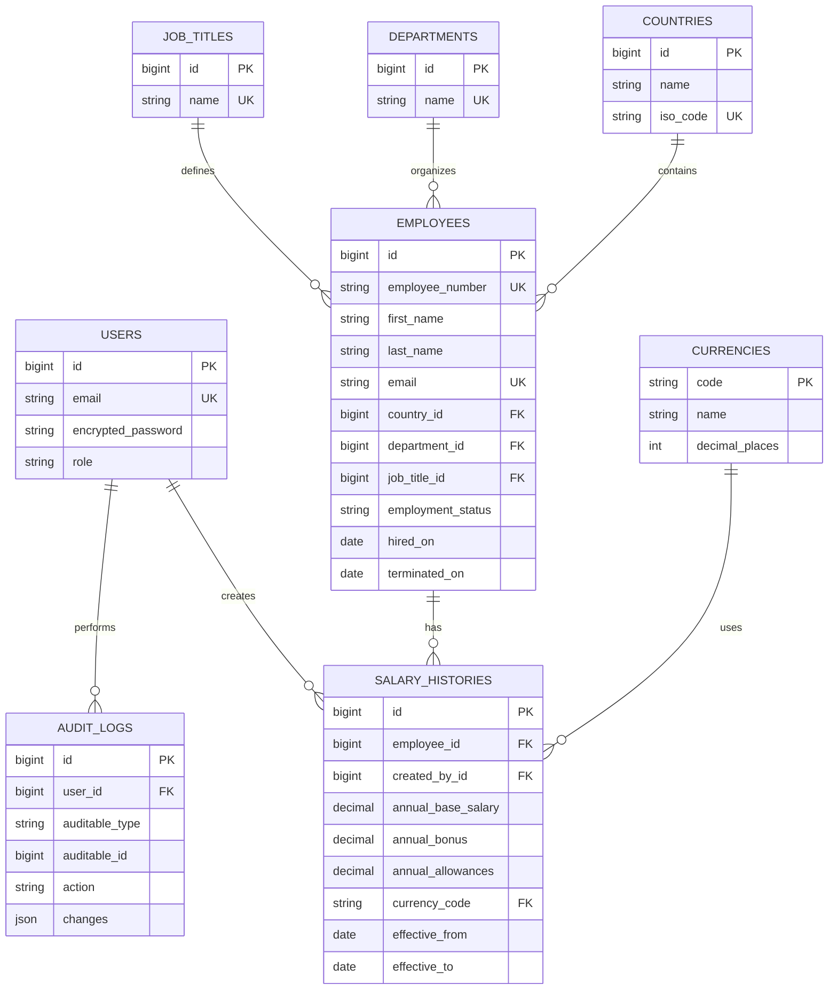

# ACME Salary Management – Database Design

**Version:** 1.0
**Database:** MySQL
**Storage Engine:** InnoDB
**Backend:** Ruby on Rails 8

## 1. Overview

The application uses a normalized relational database to manage employees, organizational information, salary records, and audit history.

The database is designed to support approximately 10,000 employees across multiple countries.

## 2. Database Entities

| Table | Purpose |
|---|---|
| users | HR authentication and authorization |
| employees | Employee information |
| countries | Country reference data |
| departments | Department reference data |
| job_titles | Designation reference data |
| currencies | ISO 4217 currency reference data |
| salary_histories | Effective-dated compensation records |
| audit_logs | Track important application changes |

## 3. Entity Relationships

- Country has many employees.
- Department has many employees.
- Job title has many employees.
- Employee has many salary histories.
- User creates many salary history records.
- User has many audit logs.
- Currency has many salary history records.
- Audit logs belong to a user and polymorphically reference the modified record.

## 4. Salary History Strategy

Salary history is the single source of truth for employee compensation.

A separate current salary table will not be maintained to avoid duplicate salary information.

Each salary record contains:

- Annual base salary.
- Annual target bonus.
- Annual allowances.
- Currency code.
- Effective start date.
- Effective end date.
- Created by.
- Change reason.

Salary periods use half-open intervals: `[effective_from, effective_to)`.

An ending date of NULL represents an open-ended period.

Salary periods belonging to the same employee must never overlap.

Salary changes must be processed inside database transactions. The employee row will be locked during concurrent salary updates to prevent overlapping records.

Historical records will be preserved instead of being overwritten.

## 5. Currency Strategy

The application supports multiple currencies using ISO 4217 codes.

Examples include INR, USD, EUR, GBP, JPY, and AED.

Monetary columns use DECIMAL(19,4) to accommodate currencies with different decimal precision.

The currencies table maintains the permitted decimal precision.

All salary analytics must group amounts by currency.

Automatic foreign exchange conversion is excluded from the initial release.

## 6. Employee Lifecycle

Employees have one of the following statuses:

- active
- inactive
- terminated

Employee records will not be physically deleted during normal operations.

This preserves historical salary information and audit records.

## 7. Audit Strategy

The audit_logs table tracks important employee and salary modifications.

It records:

- User responsible for the change.
- Modified record type and ID.
- Action performed.
- Previous and updated values.
- Timestamp.

Salary changes must generate audit entries within the same database transaction.

Audit records are append-only through the application.

## 8. Database Constraints

- Employee number must be unique.
- Employee email must be unique.
- Country ISO code must be unique.
- Department name must be unique.
- Job title name must be unique.
- Salary must not be negative.
- Salary period end date must be greater than its start date.
- Salary periods for one employee must not overlap.
- Foreign-key constraints must protect relational integrity.
- Currency codes must reference valid currencies.

## 9. Indexing Strategy

Important indexes:

### Employees
- Unique employee_number.
- Unique email.
- country_id.
- department_id.
- job_title_id.
- employment_status.
- Composite country_id, department_id, employment_status.

### Salary Histories
- Composite employee_id, effective_from.
- Composite currency_code, effective_from.
- created_by_id.

### Audit Logs
- Composite auditable_type, auditable_id.
- Composite user_id, created_at.

## 10. Performance Considerations

- Use server-side pagination.
- Use SQL aggregation for dashboard metrics.
- Avoid N+1 database queries.
- Use indexes for frequently accessed filters.
- Avoid loading all employee records into application memory.
- Use background processing for large CSV imports and exports.
- Use transactions for operations involving multiple related records.

## 11. Deliberately Excluded

The initial database design does not include:

- Payroll transactions.
- Tax calculations.
- Attendance records.
- Leave management.
- Banking information.
- Automatic exchange-rate management.

These are outside the scope of the initial salary management product.

## 12. Technology

- Ruby on Rails 8.
- MySQL 8.0.
- InnoDB.
- ActiveRecord.
- Redis and Sidekiq for background processing.

## 13. Entity Relationship Diagram

